# Diagramas

Diagramas em [Mermaid](https://mermaid.js.org/) que ilustram o funcionamento do Voto Vivo. Todos os elementos foram extraídos da documentação existente.

## 📚 Índice

1. [Visão geral da arquitetura](#1-visão-geral-da-arquitetura)
2. [Integração entre componentes](#2-integração-entre-componentes)
3. [Fontes de dados](#3-fontes-de-dados)
4. [Pipeline de ETL](#4-pipeline-de-etl)
5. [Controle de requisições externas](#5-controle-de-requisições-externas)
6. [Fluxo de uma requisição (Frontend → Banco)](#6-fluxo-de-uma-requisição-frontend--banco)
7. [Fluxo de navegação do usuário](#7-fluxo-de-navegação-do-usuário)
8. [Endpoints da API](#8-endpoints-da-api)
9. [Camadas do Backend](#9-camadas-do-backend)
10. [Estrutura do Frontend](#10-estrutura-do-frontend)
11. [Dados armazenados](#11-dados-armazenados)
12. [Ambiente de desenvolvimento](#12-ambiente-de-desenvolvimento)
13. [Fluxo de desenvolvimento](#13-fluxo-de-desenvolvimento)
14. [Infraestrutura atual](#14-infraestrutura-atual)

---

## 1. Visão geral da arquitetura

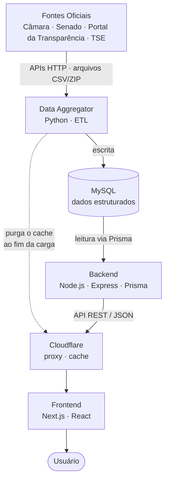

---

## 2. Integração entre componentes

Mostra quem se comunica com quem e por qual protocolo. O Frontend nunca acessa o banco diretamente; o banco é compartilhado entre Data Aggregator (escrita) e Backend (leitura). O Data Aggregator também chama a API da Cloudflare para purgar o cache depois de cada carga.

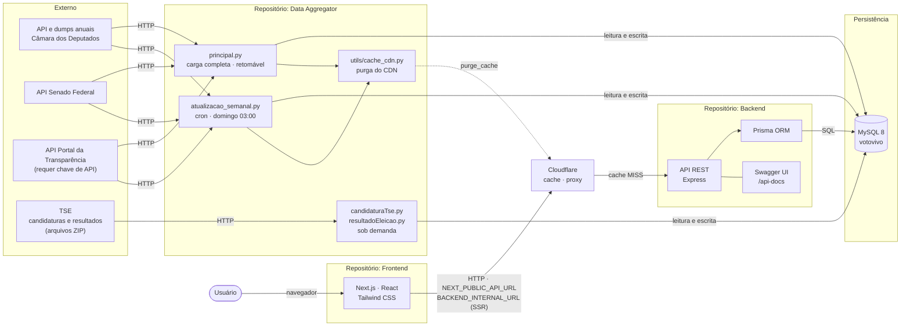

---

## 3. Fontes de dados

Origem dos dados e entidades armazenadas no banco (tabelas do `schema.sql` do Data Aggregator).

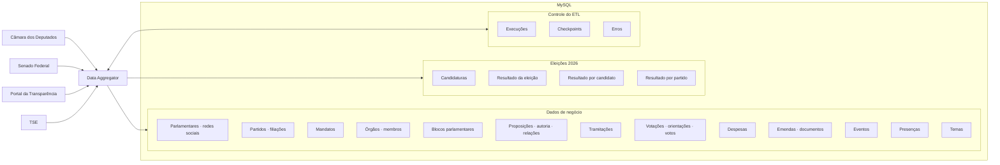

| Fonte | Alimenta |
|-------|----------|
| Câmara dos Deputados | Deputados, blocos, órgãos, proposições (dumps anuais), tramitações, eventos, despesas CEAP (CSV anual), votações, orientações de bancada e votos |
| Senado Federal | Senadores, mandatos, órgãos, proposições, tramitações, votações/presenças e despesas CEAPS |
| Portal da Transparência | Emendas parlamentares |
| TSE | Candidaturas (com foto e situação) e resultados da totalização |

---

## 4. Pipeline de ETL

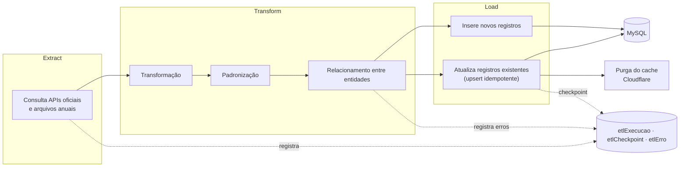

### Orquestração

Os scripts rodam em ordem, respeitando as dependências entre tabelas. A carga completa (`principal.py`) para na primeira falha e retoma do último script concluído; a atualização semanal (`atualizacao_semanal.py`) segue mesmo após falhas, mas sai com código 1. Nos dois casos o cache do CDN é purgado ao final.

```mermaid
flowchart TD
    subgraph Completa["principal.py · carga completa (26 scripts)"]
        direction LR
        A1["Parlamentares · partidos · blocos · mandatos"] --> A2["Tipos · temas · órgãos"]
        A2 --> A3["Proposições Câmara e Senado<br/>+ vínculo entre casas"]
        A3 --> A4["Despesas · emendas"]
        A4 --> A5["Tipos de tramitação · tramitações"]
        A5 --> A6["Eventos · votações · orientações · votos"]
        A6 --> A7["Vínculo emenda ↔ parlamentar"]
    end

    subgraph Semanal["atualizacao_semanal.py · domingo 03:00 (11 scripts)"]
        direction LR
        B1["Proposições + vínculo entre casas"] --> B2["Despesas"]
        B2 --> B3["Emendas"]
        B3 --> B4["Votações · orientações · votos"]
        B4 --> B5["Vínculo emenda ↔ parlamentar"]
    end

    subgraph Demanda["Sob demanda"]
        direction LR
        C1["candidaturaTse.py"] --> C2["resultadoEleicao.py"]
    end

    Completa --> P["purgar_cdn()"]
    Semanal --> P
```

---

## 5. Controle de requisições externas

Mecanismos usados pelo Data Aggregator ao chamar as APIs oficiais (`utils/http_client.py`).

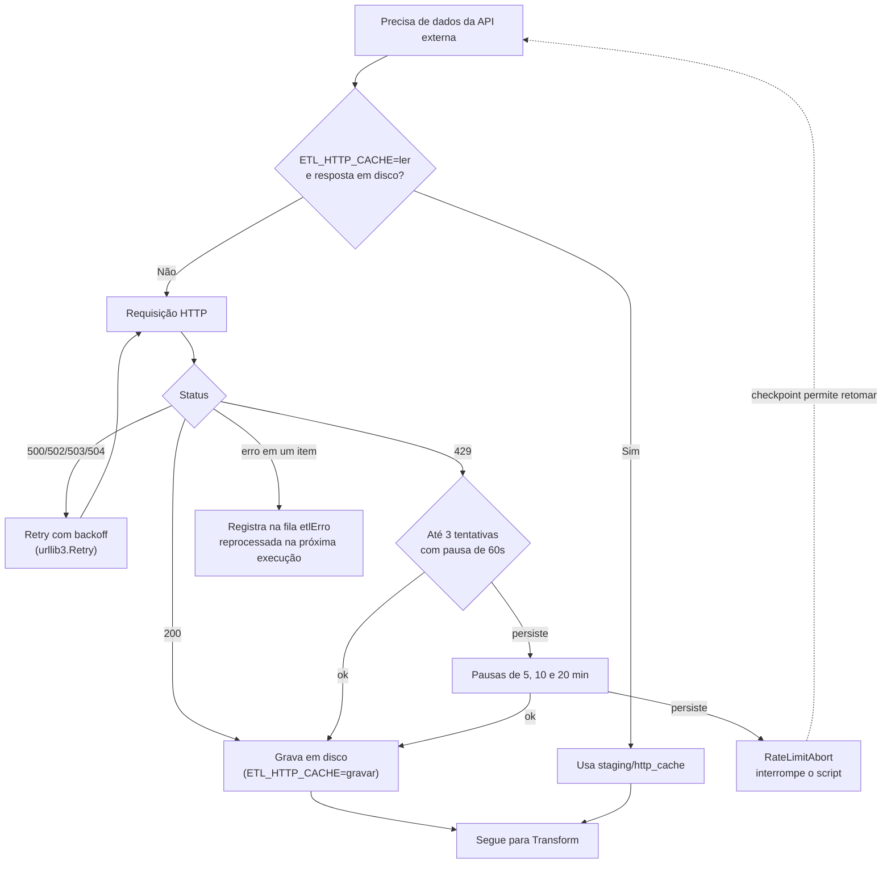

### Fetch paralelo

Os scripts de maior volume buscam as respostas em paralelo e gravam em ordem, para que o checkpoint continue válido.

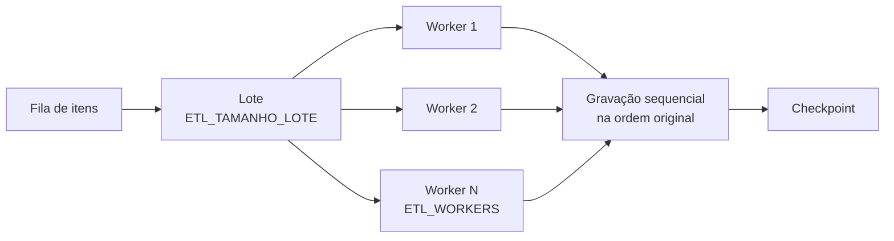

---

## 6. Fluxo de uma requisição (Frontend → Banco)

Exemplo com `GET /parlamentares`, passando pelo cache da Cloudflare.

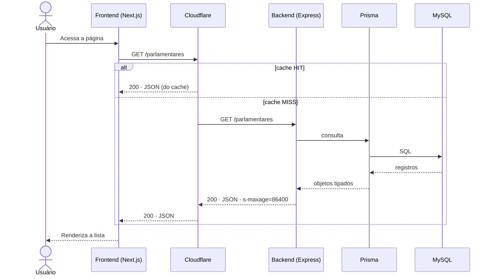

---

## 7. Fluxo de navegação do usuário

Rotas do `app/` do Frontend e os endpoints consumidos por cada uma.

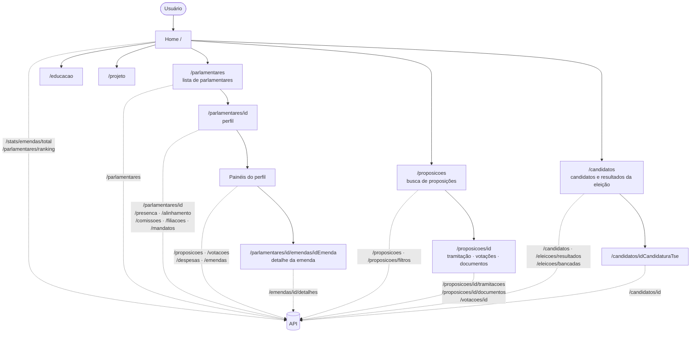

---

## 8. Endpoints da API

Endpoints consumidos pelo Frontend (`services/`).

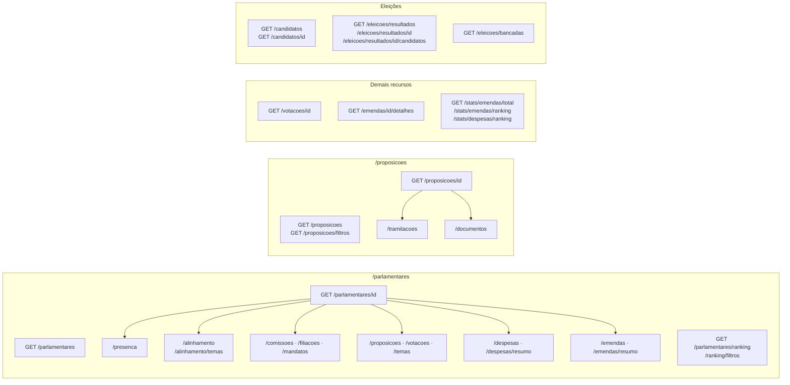

> Lista derivada das chamadas do Frontend. O Backend pode expor rotas adicionais; consulte o `swagger.yaml`.

---

## 9. Camadas do Backend

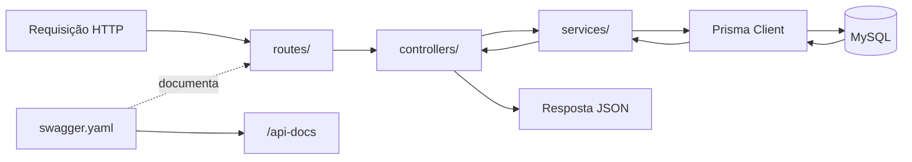

> A estrutura exata de pastas pode evoluir (a documentação indica `controllers/`, `routes/`, `services/` e `...`).

---

## 10. Estrutura do Frontend

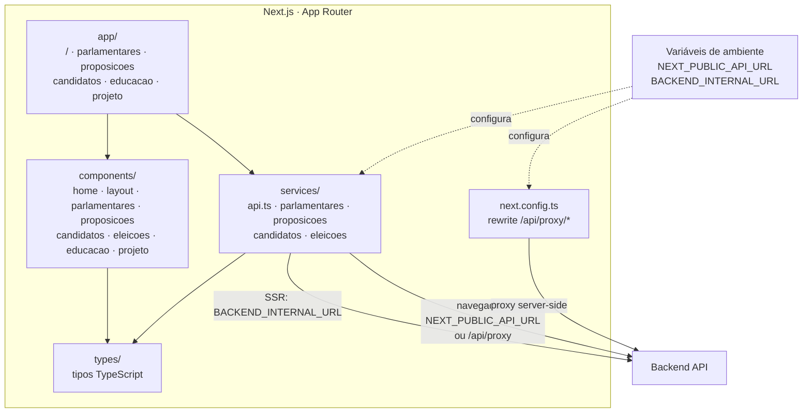

### Escolha da URL da API (`services/api.ts`)

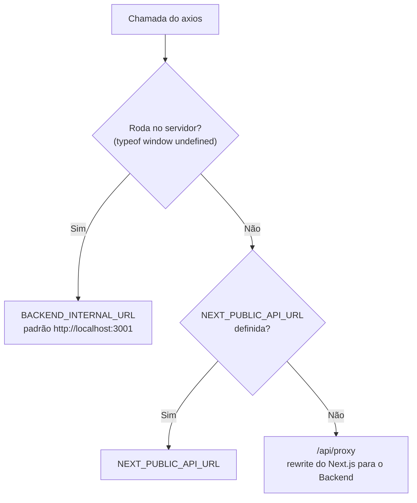

---

## 11. Dados armazenados

Visão agrupada por tema, **sem** relacionamentos exatos (a documentação não os detalha; consulte o `schema.prisma` do Backend).

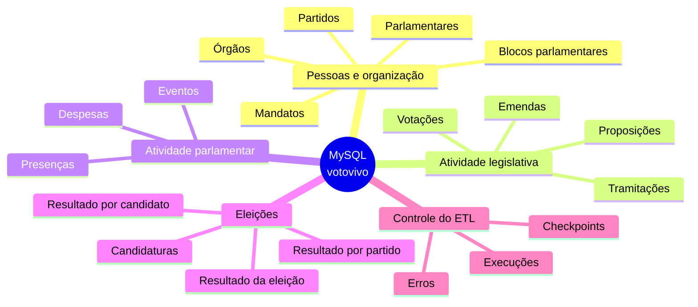

---

## 12. Ambiente de desenvolvimento

Portas e variáveis conforme os exemplos da documentação.

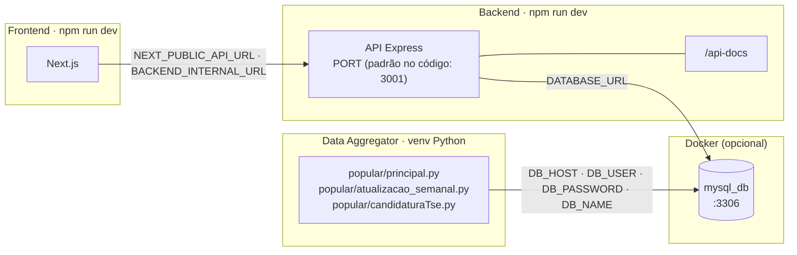

> ⚠️ **Inconsistência na documentação:** os arquivos de documentação do Backend citam `PORT=3000` e o Swagger em `localhost:3000`, mas o código usa `3001` como padrão (`src/server.ts`) e o Frontend aponta para `localhost:3001`. Os valores precisam coincidir no ambiente real.

### Ordem de subida local

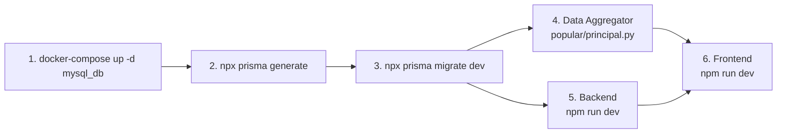

---

## 13. Fluxo de desenvolvimento

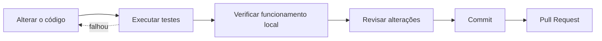

---

## 14. Infraestrutura atual

Estado atual da hospedagem: o Cloudflare atua como proxy reverso e cache na frente de todo o tráfego, tanto do Frontend quanto da API. O Frontend roda em PaaS (Vercel) integrado ao repositório. Backend e MySQL rodam em containers (`docker-compose.oracle.yml`) na instância gratuita da Oracle Cloud, e o Data Aggregator roda na mesma instância, fora dos containers, agendado por cron.

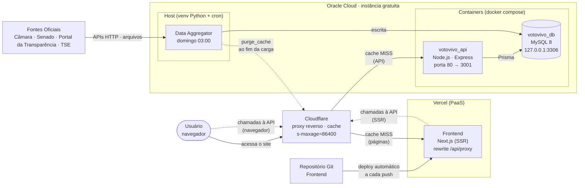

### Cache e invalidação

A API responde com `Cache-Control: s-maxage=86400`, então a Cloudflare guarda cada resposta por 24 horas e o servidor só é consultado uma vez por URL por dia. Como esse TTL é longo, o Data Aggregator purga o cache inteiro da zona ao fim de cada carga; sem a purga, dados corrigidos ficariam invisíveis por até um dia.

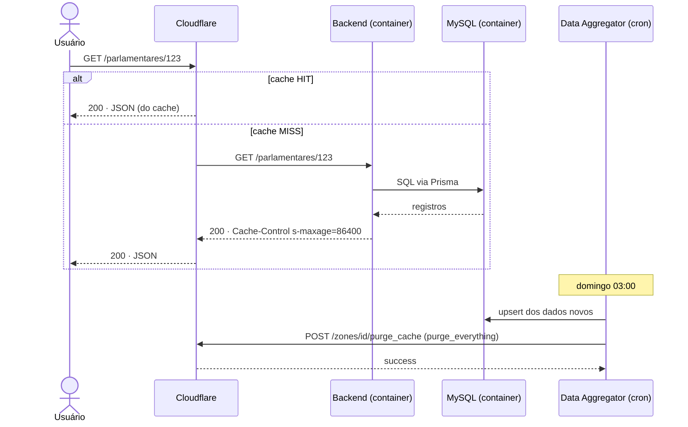

> O Data Aggregator só purga o cache se `CLOUDFLARE_ZONE_ID` e `CLOUDFLARE_API_TOKEN` estiverem configurados; uma falha na purga não reprova a carga.

---

[⬅ Voltar para o README](./README.md)
