# Diagramas

Diagramas em [Mermaid](https://mermaid.js.org/) que ilustram o funcionamento do Voto Vivo. Todos os elementos foram extraídos da documentação existente.

## 📚 Índice

1. [Visão geral da arquitetura](#1-visão-geral-da-arquitetura)
2. [Integração entre componentes](#2-integração-entre-componentes)
3. [Fontes de dados](#3-fontes-de-dados)
4. [Pipeline de ETL](#4-pipeline-de-etl)
5. [Controle de requisições externas](#5-controle-de-requisições-externas)
6. [Fluxo de uma requisição (Frontend → Banco)](#6-fluxo-de-uma-requisição-frontend--banco)
7. [Fluxo de navegação do usuário](#7-fluxo-de-navegação-do-usuário)
8. [Endpoints da API](#8-endpoints-da-api)
9. [Camadas do Backend](#9-camadas-do-backend)
10. [Estrutura do Frontend](#10-estrutura-do-frontend)
11. [Dados armazenados](#11-dados-armazenados)
12. [Ambiente de desenvolvimento](#12-ambiente-de-desenvolvimento)
13. [Fluxo de desenvolvimento](#13-fluxo-de-desenvolvimento)
14. [Infraestrutura atual](#14-infraestrutura-atual)

---

## 1. Visão geral da arquitetura

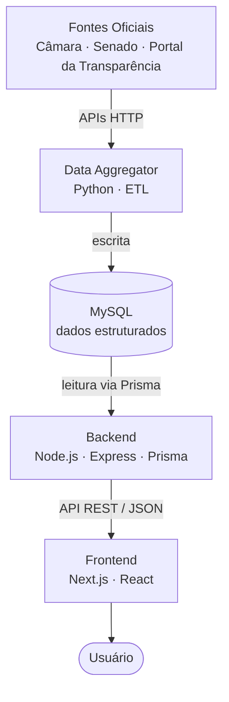

---

## 2. Integração entre componentes

Mostra quem se comunica com quem e por qual protocolo. O Frontend nunca acessa o banco diretamente; o banco é compartilhado entre Data Aggregator (escrita) e Backend (leitura).

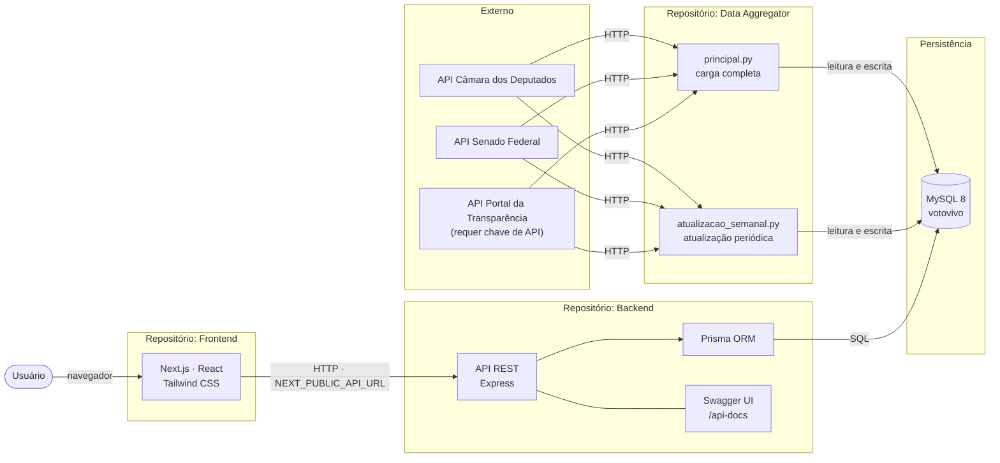

---

## 3. Fontes de dados

Origem dos dados e entidades armazenadas no banco.

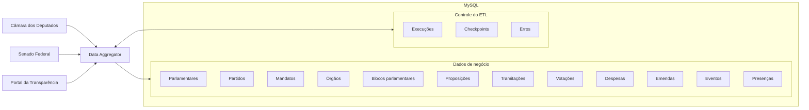

> A documentação lista os grupos de dados, mas não detalha de qual fonte vem cada entidade. Consulte o repositório do Data Aggregator para esse mapeamento.

---

## 4. Pipeline de ETL

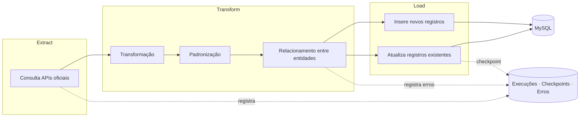

---

## 5. Controle de requisições externas

Mecanismos usados pelo Data Aggregator ao chamar as APIs oficiais.

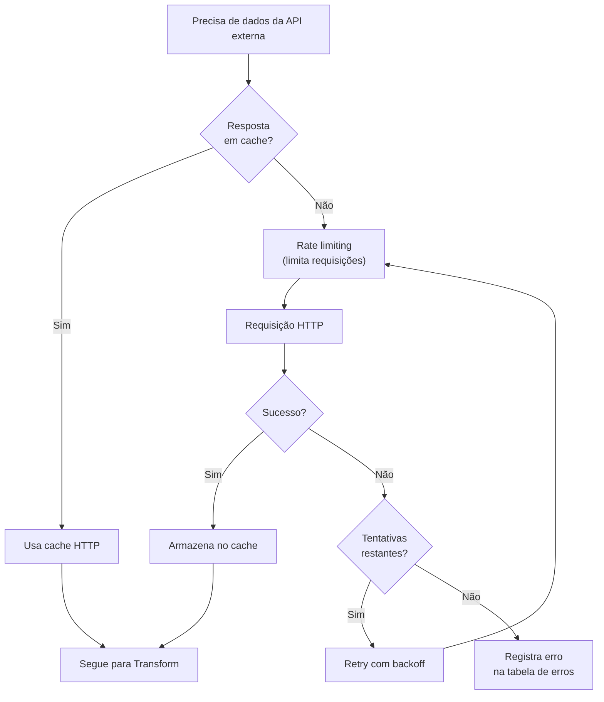

> O processamento paralelo (quando aplicável) executa vários desses fluxos simultaneamente.

---

## 6. Fluxo de uma requisição (Frontend → Banco)

Exemplo com `GET /parlamentares`.

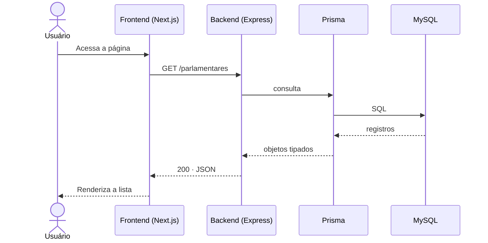

---

## 7. Fluxo de navegação do usuário

Fluxo de telas e chamadas à API, derivado dos endpoints disponíveis.

> A documentação do Frontend não descreve as páginas. O diagrama abaixo é inferido dos recursos da API; ajuste os nomes das telas conforme o `app/` real.

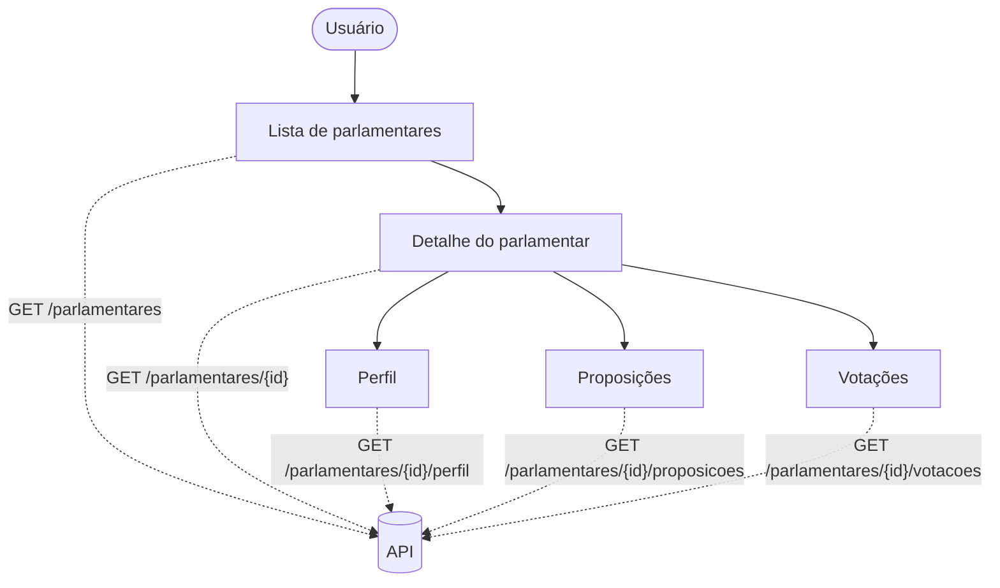

---

## 8. Endpoints da API

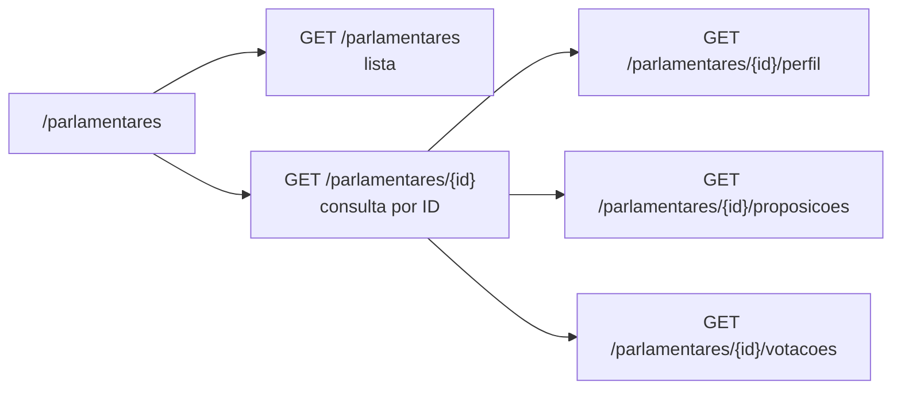

---

## 9. Camadas do Backend

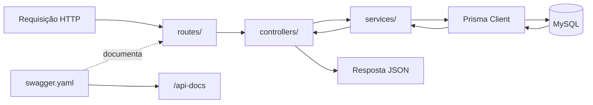

> A estrutura exata de pastas pode evoluir (a documentação indica `controllers/`, `routes/`, `services/` e `...`).

---

## 10. Estrutura do Frontend

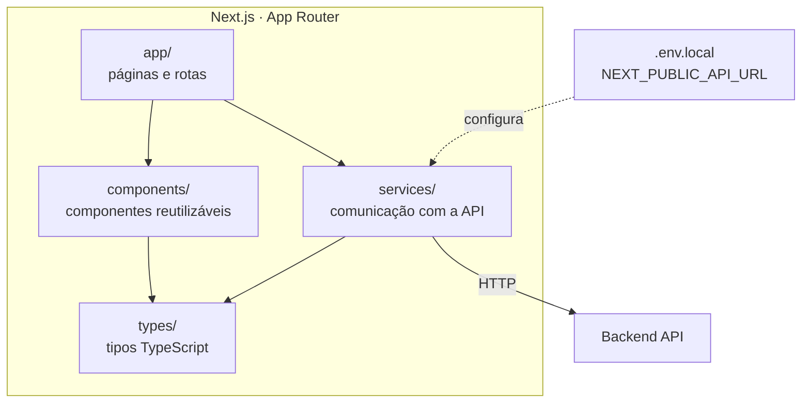

---

## 11. Dados armazenados

Visão agrupada por tema, **sem** relacionamentos exatos (a documentação não os detalha; consulte o `schema.prisma` do Backend).

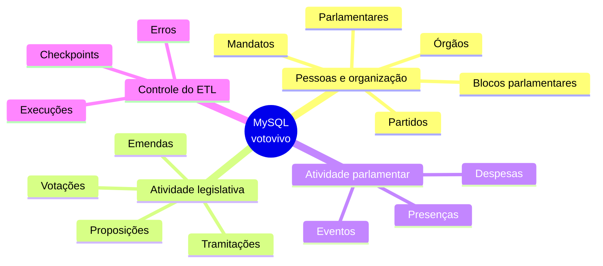

---

## 12. Ambiente de desenvolvimento

Portas e variáveis conforme os exemplos da documentação.

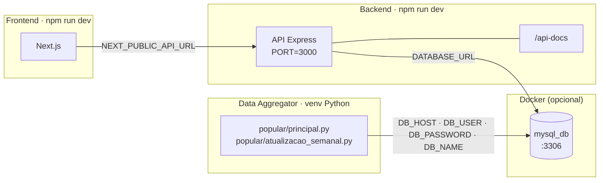

> ⚠️ **Inconsistência na documentação:** o Backend usa `PORT=3000` e o Swagger em `localhost:3000`, mas `NEXT_PUBLIC_API_URL` aponta para `localhost:3001`. Os dois valores precisam coincidir no ambiente real.

### Ordem de subida local

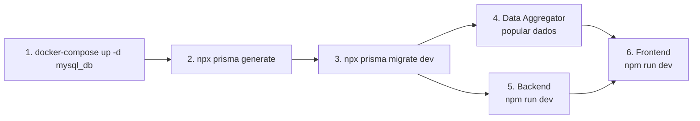

---

## 13. Fluxo de desenvolvimento

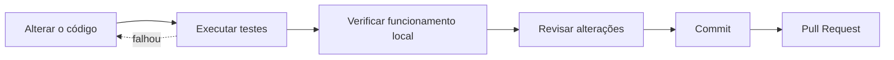

---

## 14. Infraestrutura atual

Estado atual da hospedagem: o Cloudflare atua como proxy reverso e cache na frente de todo o tráfego, tanto do Frontend quanto da API. O Frontend roda em PaaS (Vercel) integrado ao repositório. Backend, banco de dados e Data Aggregator ficam na mesma instância gratuita da Oracle Cloud, com Backend e MySQL em containers.

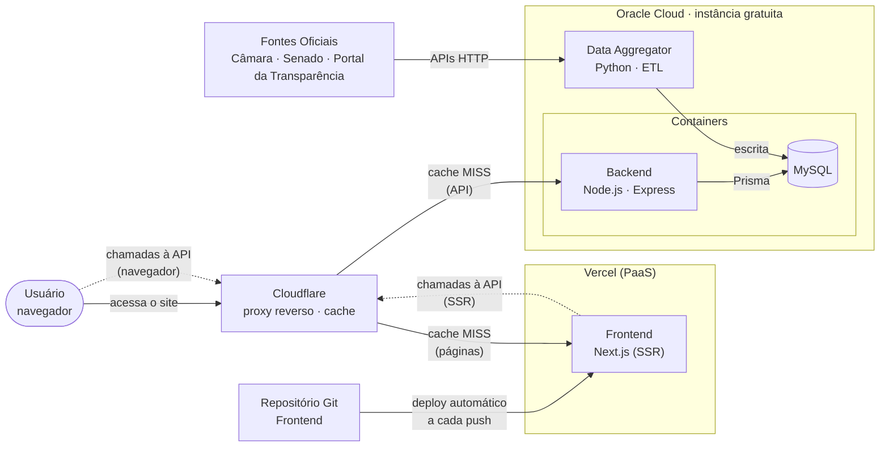

---

[⬅ Voltar para o README](./README.md)
